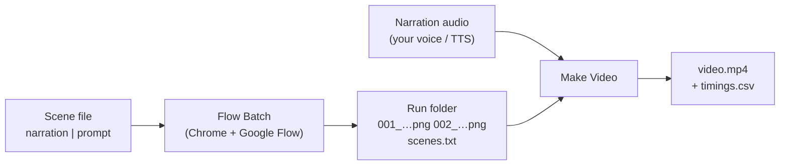

# Flow Batch

**Turn one text file into a finished YouTube video.**

Flow Batch is a small toolkit for making narrated image videos (for example
2D stickman explainers) with Google Flow:

1. **Flow Batch** (Chrome extension) – runs a list of prompts through
   [Google Flow](https://flow.google.com) one after another, optionally with
   1–2 reference images attached, and saves every generated image to a folder
   on your PC. No clicking needed once it starts.
2. **Make Video** (Windows tool) – turns those images plus one narration audio
   file into a 1920×1080 MP4, with **each image appearing exactly when its
   line of narration is spoken**.



Current version: **1.5.0** (shown in the panel title).

---

## Contents

- [What's in this repository](#whats-in-this-repository)
- [Requirements](#requirements)
- [Installation](#installation)
- [Quick start](#quick-start)
- [The full workflow, step by step](#the-full-workflow-step-by-step)
- [Scene file format](#scene-file-format)
- [Flow Batch panel reference](#flow-batch-panel-reference)
- [Output files](#output-files)
- [Make Video reference](#make-video-reference)
- [How it works](#how-it-works)
- [Code overview](#code-overview)
- [Troubleshooting](#troubleshooting)
- [FAQ](#faq)
- [Limits and account safety](#limits-and-account-safety)
- [Development notes](#development-notes)

---

## What's in this repository

| Path | What it is |
|---|---|
| `manifest.json` | Chrome extension manifest (Manifest V3) |
| `content.js` | The Flow Batch panel and all automation on the Flow page |
| `background.js` | Service worker: real clicks/keys, answering Flow's file dialog, downloads |
| `sample-scenes.txt` | Example scene file (narration \| prompt) |
| `sample-prompts.txt` | Example plain prompt file (one prompt per line) |
| `video-maker/Make Video.bat` | Double-click to open the Make Video window |
| `video-maker/Setup.bat` | One-time installer for everything Make Video needs |
| `video-maker/make_video.py` | The Make Video tool (Python + FFmpeg + Whisper) |
| `video-maker/requirements.txt` | Python package list for Make Video |
| `SCENE-WRITER-PROMPT.md` | Ready-to-paste prompt: Claude/ChatGPT turns your script into a scene file |
| `PROMPT.md` | A ready-made prompt for continuing development with an AI assistant |

---

## Requirements

| For | You need |
|---|---|
| Flow Batch | Google Chrome (desktop), a Google account with access to Google Flow and its credits |
| Make Video | Windows 10/11, Python 3.10+, FFmpeg, the `faster-whisper` package and its speech model (~480 MB) – `Setup.bat` installs all of these |
| Updating | Git (to `git pull` new versions), or download the ZIP from GitHub |

---

## Installation

### 1. Get the code

```
git clone https://github.com/saifullahraodev-prog/flow-batch.git
```

(The repository is private – the computer must be signed in to your GitHub
account. Alternatively use **Code → Download ZIP** on GitHub and unzip it.)

### 2. Install the Chrome extension

1. Open `chrome://extensions` in Chrome.
2. Turn on **Developer mode** (top right).
3. Click **Load unpacked** and select the `flow-batch` folder (the one that
   contains `manifest.json`).
4. Click the puzzle-piece icon on the toolbar and **pin** Flow Batch.
5. Open https://flow.google.com – the **Flow Batch** panel appears in the
   bottom-right corner, with the version number in its title.

### 3. Install Make Video (once per computer)

Double-click **`video-maker\Setup.bat`**. It:

1. checks Python (installs it with winget if missing – then close the window
   and run `Setup.bat` again),
2. installs FFmpeg if missing (`winget install Gyan.FFmpeg`),
3. installs the speech library (`pip install -r requirements.txt`),
4. downloads the speech model (~480 MB, first time only).

It skips anything already installed, so it is safe to run again. When it
says **"All set!"** you're done.

### Updating to a new version

```
cd flow-batch
git pull
```

Then in `chrome://extensions` click **reload** (↻) on Flow Batch and refresh
the Flow tab. Check the panel title shows the new version. Make Video needs
nothing extra unless the release notes say so (then run `Setup.bat` again).

---

## Quick start

1. In Flow: open a project, choose model and image count.
2. In the Flow Batch panel: **Scene Builder…** → paste your script →
   **Split into scenes** → (optionally type a picture for some scenes) →
   **Use these scenes**.
3. Type a **Style**, (optional) **Reference images…**, **Start**.
4. Record your script as one audio file.
5. **Make Video.bat** → pick the run folder + the audio → **Make video**.

---

## The full workflow, step by step

### Step 1 – Turn your script into scenes

**The idea:** your video is a series of *scenes*. In each scene, the narrator
says a sentence (or a few) while one picture is on screen. Flow Batch needs to
know, for every scene, **what is said** and **what picture to show**.

#### The easy way: Scene Builder (recommended)

You only need your script – plain text, exactly as you will read it.

1. Open Flow; in the Flow Batch panel click **Scene Builder…**. A large editor
   opens over the page.
2. **Paste your script** into the top box. (Optional: put a line
   `## Chapter title` where a YouTube chapter should start.)
3. Pick a **Scene length** – *Short* (about 1 sentence, ~5 s per picture),
   *Medium* (~2 sentences), *Long* (~3 sentences), or *Each line I wrote = one
   scene* if you already split it yourself – and type a **Video name**.
4. Click **Split into scenes**. You get a table:

   | # | Narration – what is said | Picture – optional |
   |---|---|---|
   | 1 | In 1912 the Titanic left Southampton on her first voyage. | *(empty – grey: the sentence is used)* |
   | 2 | She was the largest ship ever built, and Captain Smith was proud of her. | stickman captain with a white cap standing proudly on the deck |

   - The **Picture** box is optional. Left empty, the narration sentence itself
     (plus your Style) is sent to Flow – it is shown in grey so you can see it.
     Type a description only where you want a specific picture.
   - **↑ Merge** joins a scene onto the one above, **✂ Split** cuts a scene in
     two at a natural place (between sentences or at a comma), **Delete**
     removes it, **+ Add scene** adds one at the end. You can also edit any
     text directly, and add chapter titles per scene.
   - Paragraphs (blank lines) in your script always start a new scene.
5. Click **Use these scenes** – they appear in the panel list, ready to Start.
   **Save .txt** keeps a copy as a scene file you can load again later.

Your script and the table are kept automatically – closing the editor or
reloading the page loses nothing.

#### Other ways

- **Let an AI write the pictures:** [`SCENE-WRITER-PROMPT.md`](SCENE-WRITER-PROMPT.md)
  is a prompt for Claude/ChatGPT that turns your script into a complete scene
  file with a tailored picture for every scene. Save the answer as a `.txt`
  and load it with **Load .txt file…**.
- **Write the scene file yourself**, as described below.

#### The scene file (what Scene Builder makes for you)

A scene file is a plain `.txt` with **one line per scene**; each line says the
two things, separated by a `|` (the vertical bar, `Shift` + `\`):

```
what the narrator says   |   what the picture shows
```

**Example** – a 3-scene video:

```
In 1912 the Titanic left Southampton. | stickman sailors waving from a huge ship leaving the port
The captain was proud of his ship. | stickman captain smiling on the deck
That night, the lookout saw an iceberg. | stickman lookout pointing at an iceberg
```

What each line becomes:

| Scene | Narrator says (left of `\|`) | Picture on screen (right of `\|`) |
|---|---|---|
| 1 | "In 1912 the Titanic left Southampton." | sailors waving from a ship leaving port |
| 2 | "The captain was proud of his ship." | the captain smiling on deck |
| 3 | "That night, the lookout saw an iceberg." | the lookout pointing at an iceberg |

- The **left side** is your narration script. You will read (or text-to-speech)
  exactly this, in this order, in Step 6. It never goes to Flow.
- The **right side** is the image prompt. Only this goes to Flow. Describe just
  the scene – the shared look (*"2D stickman cartoon, white background"*) goes
  in the panel's **Style box** in Step 3, so you don't repeat it on every line.
- Start a new line wherever the picture should change. A scene can be one
  short sentence or several sentences – as long as they stay on one line.

**To write one by hand:** open **Notepad**, type one scene per line as above,
then **File → Save as** `titanic.txt` (*Encoding: UTF-8*), and load it with
**Load .txt file…**. The run folder and the video are named after it.

**Chapters (optional):** a line `## Chapter title` before a scene starts a
YouTube chapter there – Make Video puts the chapter list in the video's
description file (Step 8).

A ready example is in [`sample-scenes.txt`](sample-scenes.txt). All rules are
in [Scene file format](#scene-file-format).

### Step 2 – Prepare Google Flow

1. Open https://flow.google.com and sign in.
2. Open an existing project or create a new one.
3. In the prompt bar choose the **model**, the **aspect ratio** (16:9 for
   YouTube) and the **number of images** per prompt (e.g. `x2`).
4. Make sure **Agent** mode is off – the extension sends plain prompts.

Flow Batch uses whatever is selected in Flow; it reads the `xN` count itself.

### Step 3 – Run Flow Batch

In the panel (bottom-right of the Flow page):

1. Your scenes from Step 1 are already in the list (or use **Load .txt file…**
   for a scene file).
2. **Style box** → type the look shared by all images, e.g.
   `2D stickman cartoon, flat colours, white background`.
3. *(Optional)* **Reference images…** → pick 1 or 2 images (a character, a
   logo…). They are attached in Flow for every prompt.
4. **Save folder…** → the first time, choose where results go (e.g.
   `Desktop\Flow videos`). Chrome asks once for permission.
5. Click **Start**.

Chrome shows a bar *"Flow Batch started debugging this browser"* – leave it,
it disappears when the run ends. You can use other tabs meanwhile, but keep the
Flow tab open.

For each scene the extension: attaches the references → types the style +
prompt → clicks generate → waits for the images → saves them → waits a few
seconds → next scene.

### Step 4 – Fix failures

When the run ends, the panel shows e.g. *"20 prompts, 18 done, 2 failed"*.
Click **Retry failed (2)** – only those two run again, saving into the same
folder.

### Step 5 – Review the images (optional)

Open the run folder. With `x2` you get two images per scene
(`005_…_1.png`, `005_…_2.png`). The video uses `_1` by default – if you prefer
the `_2`, simply **delete the `_1`**. You can also replace any image with your
own, as long as the file name starts with the scene number (`005_…`).

### Step 6 – Record the narration

Record (or generate with text-to-speech) the **left-hand side of every line,
in order**, as **one** audio file (`.mp3`, `.wav`, `.m4a`…).

- Small slips are fine – the matching is tolerant.
- Don't skip, swap or add whole sentences. If you want an intro, make it its
  own scene line.

### Step 7 – Make the video

1. Double-click **`video-maker\Make Video.bat`**.
2. **Images folder** → the run folder from Step 3.
3. **Narration audio** → your recording.
4. Leave **Script** empty – the folder's `scenes.txt` is used automatically.
   Check the summary says **"✓ Every scene has an image"**.
5. *(Optional)* **Background music** → a music file, and its volume
   (Quiet / Medium / Loud). It loops if shorter than the video, fades out at
   the end, and automatically gets quieter while the narrator speaks.
6. *(Optional)* tick **Slow zoom on images** – each picture slowly zooms in or
   out (alternating), which keeps still images feeling alive.
7. Click **Make video**.

The tool first listens to the narration (progress bar 0–45 %), then builds the
video. When it's done it offers to open the folder.

### Step 8 – Check and upload

Next to the video you'll find:

| File | Use on YouTube |
|---|---|
| `….mp4` | The video to upload |
| `….srt` | **Subtitles** – in YouTube Studio: *Subtitles → Add language → Upload file → With timing*. Spelled exactly like your script |
| `…_youtube.txt` | **Description with chapters** – copy the chapter list into the video's description; YouTube turns it into clickable chapters |
| `…_timings.csv` | For you: when each picture starts (to check timing) |

Watch the video once, then upload.

---

## Scene file format

```
# Lines starting with # are notes and are skipped.
Narration for scene 1. | image prompt for scene 1
Narration for scene 2. | image prompt for scene 2
```

| Rule | Detail |
|---|---|
| One line = one scene = one picture | Line 1 → images `001_…`, line 2 → `002_…`, … |
| Separator | The **first** `\|` on the line splits narration (left) from prompt (right) |
| Chapters | A line `## Chapter title` starts a chapter at the next scene. Used for the YouTube description; Flow Batch keeps these lines in `scenes.txt` |
| Comments | Other lines starting with `#`, and empty lines, are ignored |
| Encoding | Save as UTF-8 (Notepad's default) |
| Plain prompt files | Lines **without** `\|` are treated as prompts only (no narration). Make Video then needs a separate script, or uses equal timing |
| Long prompts | Choose *"Separated by blank line"* in the panel to allow prompts over several lines (plain prompt files only) |

The prompt actually sent to Flow is: **Style** + `, ` + prompt. Hover a scene
in the panel list to see its narration and full prompt.

---

## Flow Batch panel reference

### Main controls

| Control | What it does |
|---|---|
| **Scene Builder…** | Opens the editor: paste a plain script → split into scenes → optional pictures, chapters, merge/split/delete → **Use these scenes** / **Save .txt**. Work is kept automatically |
| **Load .txt file…** | Loads a scene file or prompt file. Loading a new file starts a new run folder |
| *One prompt per line / Separated by blank line* | How the file is split |
| **Style box** | Text added in front of every prompt |
| **Reference images…** | Up to 2 images attached to Flow's prompt for every scene. Remove one with its **×** |
| **Save folder…** | Where results are saved (chosen once, remembered) |
| Progress bar & list | ○ pending · ⏳ running · ✅ done · ⚠️ timed out · ❌ failed |
| **Start / Resume** | Runs every scene not yet done. After a reload or Stop it says *Resume* |
| **Pause / Continue** | Holds the run after the current scene finishes |
| **Stop** | Stops after the current step |
| **Retry failed (N)** | Re-runs only failed/timed-out scenes into the same folder |
| **Reset** | Marks every scene as not done (to run the whole list again) |
| Log | What happened, step by step – send a screenshot of it when reporting a problem |
| **–** / **×** | Minimise / hide the panel (click the toolbar icon to show it again) |

### Settings

| Setting | Default | Meaning |
|---|---|---|
| Images per prompt | 1 | Used only if Flow's `xN` count can't be read. Otherwise Flow's own setting wins |
| Wait between prompts (s) | 5 | Pause before the next scene. 20–30 s is a more human pace |
| Done when no new image for (s) | 10 | Finish a scene early if fewer images than expected arrive |
| Give up after (s) | 240 | A scene producing nothing for this long is marked ⚠️ and skipped |
| Download images automatically | on | Save results to the save folder |
| Fallback Downloads sub-folder | `FlowBatch` | Used only if no save folder is chosen (Chrome's Downloads folder) |

### Advanced (only if auto-detection fails)

| Field | Use |
|---|---|
| Prompt box CSS selector | Override how the prompt box is found |
| Generate button CSS selector | Override how the generate button is found |
| **Test detection** | Outlines the detected prompt box and button in red and logs what was found |

To get a selector: right-click the element in Flow → **Inspect** → right-click
the highlighted line → **Copy → Copy selector**.

### Progress is remembered

The scene list, statuses, style, references and settings are stored by the
extension. If the page reloads or Chrome restarts, the panel comes back and
**Resume** continues where it stopped.

---

## Output files

```
<your save folder>\
└── titanic_2026-10-26_1530\          ← one folder per run: <file name>_<date>_<time>
    ├── scenes.txt                     ← narration | prompt per scene (for Make Video)
    ├── 001_stickman-sailors-waving-from-a-huge_1.png
    ├── 001_stickman-sailors-waving-from-a-huge_2.png
    ├── 002_stickman-captain-smiling-on-the-deck_1.png
    ├── …
    ├── titanic_2026-10-26_1530.mp4            ← made by Make Video
    └── titanic_2026-10-26_1530_timings.csv    ← made by Make Video
```

- Image names: `<scene number>_<first words of the prompt>_<image number>.<ext>`.
- Identical images reached through two addresses are saved only once.
- **Resume** and **Retry failed** keep writing into the same run folder; loading
  a new file starts a new one.

---

## Make Video reference

### The window

| Field | Meaning |
|---|---|
| 1. Images folder | A run folder from Flow Batch (or any folder of images) |
| 2. Narration audio | One audio file for the whole video: mp3, wav, m4a, aac, ogg, flac |
| 3. Script (optional) | Only needed if the folder has no `scenes.txt`. A `.txt` with one narration line per scene (scene-file lines are fine too) |
| Only the first image of each prompt | On: one image per scene (`_1`, or `_2` if `_1` was deleted). Off: all images of a scene share its time |
| Background music (optional) | A music file and its volume (Quiet / Medium / Loud). Loops, fades out over the last 3 s, and dips about 8 dB whenever the narrator speaks. **✕** clears it |
| Slow zoom on images | Each image slowly zooms in or out by 8 % (alternating). Takes longer to build |
| Border | White or black bars around images that are not 16:9 |
| Summary line | Number of scenes, chapter titles and images, ✓ if every scene has an image, or which scenes are missing |

### How the timing is decided

- **With a script / scenes.txt** – the narration is transcribed on your PC
  (Whisper `small` model, nothing is uploaded). The script's words are matched
  to the spoken words, and each image starts **0.15 s before its line's first
  word**. Each image is shown at least 0.5 s. A matching score is shown
  (e.g. *"92 % of the script's words were found"*) – below 50 % means the
  script and audio probably don't belong together.
- **Without any script** – every image gets an equal share of the audio.

### Pairing images with scenes

Images are paired by the **number at the start of their file name**
(`007_…` = scene 7), not by position. So:

| Situation | Result |
|---|---|
| A scene has no image (failed or deleted) | The window names the scene. Click **No** to retry it in Flow Batch first, or **Yes** to continue – the previous image stays on screen during that scene |
| The first scene has no image | The next available image starts at 0:00 |
| Images without a scene number (e.g. `thumbnail.png`) | Left out |
| Your own images without numbers + a script | Paired in name order; the number of images must equal the number of lines |

### Try it with the test pack

`video-maker/test-pack/` is a ready-made example: 6 images (each shows
**SCENE n** and its narration line), a 33-second spoken `narration.mp3`, and a
`scenes.txt` – exactly what a Flow Batch run leaves behind.

1. Copy the `test-pack` folder somewhere (e.g. the Desktop), so the test video
   isn't created inside the repository.
2. **Make Video.bat** → *Images folder*: the copy, *Narration audio*: its
   `narration.mp3`, *Script*: leave empty.
3. The summary should say *"6 scenes (from scenes.txt in the folder), 6 image(s).
   ✓ Every scene has an image."* → **Make video**.
4. Play the video: each "SCENE n" card should appear just as its sentence
   starts. Expected starts: 0:00, 0:07.3, 0:12.1, 0:17.2, 0:22.2, 0:26.9
   (also listed in the `_timings.csv`).

To test a missing scene, delete `003_…png` from your copy before step 2: the
tool reports *"No image for scene(s) 3"*, and if you continue, SCENE 2 stays
on screen until scene 4 starts.

### Output

- `<folder name>.mp4` – 1920×1080, 30 fps, H.264 video, AAC 192 kbps audio,
  same length as the narration, ready for YouTube.
- `<folder name>.srt` – subtitles *(only with a script / scenes.txt)*. The
  words come from your script (so names are spelled right), timed from the
  narration: one sentence per subtitle when it fits (~42 characters, ≤ 5 s),
  longer sentences split into even parts, preferably at commas.
- `<folder name>_youtube.txt` – description text with the chapter list
  *(only with a script / scenes.txt)*:
  - with `## Chapter title` lines in the scene file → those chapters
    (an "Intro" is added at 0:00 if the first title starts later);
  - without → about one chapter per minute, titled from the narration;
  - YouTube's rules are applied: first chapter at 0:00, at least 3 chapters,
    each at least 10 s. A video too short for that gets no chapter list.
- `<folder name>_timings.csv` – opens in Excel:

| Column | Meaning |
|---|---|
| scene | Scene number |
| image | Image file(s) used, or *(no image – previous one stays)* |
| starts_at | Start time in the video (m:ss.ss) |
| seconds | How long the scene is on screen |
| chapter | Chapter title starting at this scene (if any) |
| narration | The narration line for that scene |

### Speed

A 30-second video takes about a minute; a 10-minute video a few minutes
(most of the time is spent listening to the narration). **Slow zoom** adds
time, since every frame is drawn separately.

---

## How it works

### Flow Batch – one scene

1. **References** – if reference images are set and not already attached,
   click Flow's **+** (*Add ingredients to the prompt box*). Flow opens its asset
   picker (a full-screen dialog on narrow windows, a popover on wide ones).
   If the image is already in the project it is picked by name; otherwise
   **Upload media** is clicked and the extension answers the file dialog itself
   (no Windows file picker). Then the asset is clicked and, on wide screens,
   **Add to prompt**. Success = Flow shows an *Ingredient* chip in the prompt
   box. If this fails, the run stops (so no credits are spent on wrong images).
2. **Prompt** – Style + prompt are typed into Flow's prompt box.
3. **Submit** – the **Start generation** button is clicked with a *real* mouse
   click. If Flow doesn't react within 6 s, Enter is tried, then other methods.
   It never re-submits a prompt Flow has accepted.
4. **Wait** – new images on the page are counted (by Flow's image ID, so the
   grid tile and the large preview count once) until Flow's `xN` images have
   arrived, or no new image appears for *Done when…* seconds, or *Give up after*
   is reached.
5. **Save** – images are fetched and written into the run folder; identical
   files are skipped.

### Why "debugging this browser"?

Flow ignores clicks and key presses created by scripts. The extension
therefore sends real input through Chrome's DevTools protocol
(`chrome.debugger`), which is also how it answers Flow's file dialog. Chrome
shows the debugging bar while that is attached; it is detached when the run
ends.

### Make Video – pipeline

1. **Plan** – pair images with scenes by number; read `scenes.txt` or the script.
2. **Listen** – decode the narration with FFmpeg to 16 kHz mono and transcribe
   it with faster-whisper (word timestamps).
3. **Align** – match script words to spoken words (`difflib`), take each
   line's first matched word as its start; lines with no recognised words are
   placed between their neighbours.
4. **Prepare** – scale/pad every image to exactly 1920×1080.
5. **Subtitles & chapters** – script words get the spoken times (missed words
   interpolated) → `.srt`; chapter starts from `##` lines or one per minute →
   `_youtube.txt`.
6. **Picture track** – still images joined with their durations, or (slow zoom)
   one zoompan clip per image with frame counts from the running total so cuts
   stay exact, then joined.
7. **Sound** – the narration; with music, the music is looped, faded out and
   ducked under the voice (`sidechaincompress`), then mixed. A mono voice is
   copied to both channels at full level.

---

## Code overview

### `content.js` (runs on the Flow page)

| Area | Main functions |
|---|---|
| State & storage | `DEFAULTS`, `state`, `save()`, `load()` – settings and progress in `chrome.storage.local` |
| Scene file | `parseScenes()` (scenes + `##` chapters), `splitScene()` (narration \| prompt), `fullPrompt()` (adds the style) |
| Scene Builder | `splitScript()` (script → scenes by sentences, paragraphs, chosen length), `sentencesOf()`, `splitLong()`, `splitInTwo()`, `rowsToSceneFile()`, `renderBuilder()` and the `sb…` handlers |
| Finding Flow's UI | `findPromptBox()`, `findGenerateButton()`, `findComposer()`, `findComposerCard()` |
| Typing & submitting | `setText()` (insertText, works with Flow's ProseMirror editor), `submitPrompt()`, `waitSubmitted()`, `watchPage()` |
| Real input | `trusted()`, `trustedClickOn()` – ask `background.js` for real clicks/keys |
| References | `ensureReferences()`, `ATTACH.picker` (Flow's asset dialog/popover), `findPlusButton()`, `findAssetDialog()`, `findAssetOption()`, `findAddToPrompt`, `refThumbs()` |
| Results | `collectImages()` + `imageKey()` (dedupe by Flow image ID), `flowImageCount()` (reads `xN`), `runOne()` |
| Saving | `chooseFolder()`, `folderReady()` (File System Access API, handle in IndexedDB), `writeToRun()`, `saveImages()`, `saveSceneFile()`, `getBlob()` |
| Run loop | `start()`, `newRunFolder()`, Retry/Reset/Pause/Stop handlers |
| Panel UI | Shadow-DOM panel markup, `render()`, `log()`, `setRowNote()` |

### `background.js` (service worker)

| Message | What it does |
|---|---|
| `trustedClick {x, y}` | Real mouse click via `Input.dispatchMouseEvent` |
| `trustedEnter`, `trustedKey {key}` | Real Enter / Escape via `Input.dispatchKeyEvent` |
| `armFileChooser {refs}` / `awaitFileChooser` / `disarmFileChooser` | Intercept Flow's file dialog (`Page.setInterceptFileChooserDialog`) and put the reference image into the `<input type=file>` |
| `fetchDataUrl {url}` | Fetch an image without page CORS limits (for saving) |
| `download {url, filename}` | Save via `chrome.downloads` (fallback when no folder is chosen) |
| `detach` | Remove the debugger (and its bar) when a run ends |

### `video-maker/make_video.py`

| Function | Purpose |
|---|---|
| `find_tool()` | Find FFmpeg/ffprobe on PATH or in winget's install folder |
| `pick_images()`, `scene_number()` | List images in natural order; one per scene if wanted |
| `read_script()`, `find_script()`, `plan_scenes()` | Read narration, auto-find `scenes.txt`, pair images with scenes, report missing/extra |
| `load_audio_16k()`, `transcribe_words()` | Decode audio with FFmpeg; Whisper word timestamps |
| `scene_starts()` | Align script lines to spoken words → start time per scene |
| `parse_scene_file()` | Narration lines and `## chapter` titles from a scene file |
| `align()`, `scene_starts()` | Match script words to spoken words → start time per scene |
| `word_timeline()`, `subtitle_cues()`, `srt_time()` | Script words with spoken times → `.srt` subtitles |
| `make_chapters()`, `write_youtube_text()` | YouTube chapter list (rules applied) → `_youtube.txt` |
| `build_video()` | Shots, timings CSV, image fitting, picture track (still or slow zoom), sound (narration + ducked music) |
| `App` | The Tkinter window |

Tunable constants at the top of `make_video.py`: `WIDTH`, `HEIGHT`, `FPS`,
`WHISPER_MODEL`, `LEAD_IN`, `MIN_SCENE`, `ZOOM`, `MUSIC_LEVELS`,
`SUB_MAX_CHARS`, `SUB_MAX_SECONDS`, `CHAPTER_MIN`.

---

## Troubleshooting

### Flow Batch

| Problem | What to do |
|---|---|
| Panel doesn't appear | Make sure you're on `flow.google.com`; reload the extension in `chrome://extensions` and refresh Flow; click the toolbar icon (the panel may be hidden) |
| Panel shows an old version | `git pull`, then reload the extension and refresh Flow |
| Prompt typed but not submitted | Check the log. Run **Advanced → Test detection**; make sure Agent mode is off; leave the "debugging" bar open |
| "Could not attach reference image" | Read the `·` step lines in the log just above it – they show which step failed (dialog not opening, upload, *Add to prompt*). Send a screenshot of the log |
| Images saved twice | Update to 1.2.0 or newer (dedupe by image ID) |
| "Save as" box for every image | Choose a **Save folder…** in the panel. (Chrome Downloads is only the fallback) |
| Chrome asks again for folder permission | Normal after a browser restart – choose *Allow on every visit* |
| Errors listed in `chrome://extensions` | Click **Clear all**, reload the extension, try again – old errors stay listed until cleared |
| A scene times out (⚠️) | Flow was slow or refused the prompt; use **Retry failed**, or raise *Give up after* |

### Make Video

| Problem | What to do |
|---|---|
| "FFmpeg is not installed" | Run `Setup.bat` |
| "The speech library isn't installed for the Python that runs this tool" (even though you installed it) | The PC has more than one Python. `git pull` the latest version and run `Setup.bat` again – Setup and Make Video now use the same Python, and the message shows which one ran |
| "The speech library is installed but Windows can't load it" / "DLL load failed" | Run `Setup.bat` again – it installs the Microsoft Visual C++ Redistributable. Or: `winget install Microsoft.VCRedist.2015+.x64` |
| Model download very slow / stuck | Run `Setup.bat` again – it resumes. The tool uses plain HTTP downloads for reliability |
| "No image for scene(s) …" | Retry those scenes in Flow Batch, or continue (previous image stays) |
| "The script has N lines but there are M images…" | Only for images without scene numbers: make the counts equal, or name images `001_…` |
| Low "% of words found" | The audio and script don't match – check you picked the right audio / that the narration follows the script |
| Picture changes a bit early | By design (0.15 s lead-in so it appears as the sentence starts). Change `LEAD_IN` in `make_video.py` if wanted |
| Video shows only one image throughout | `git pull` the latest version (images of different sizes are now fitted to 1920×1080 first) |
| `Make Video.bat` does nothing | Run `python make_video.py` in the `video-maker` folder to see the error; re-run `Setup.bat` |

---

## FAQ

**Do I have to use a scene file?**
No. A plain prompt file (one prompt per line) works for images. For a video
you then either pick a separate script in Make Video, or get equal timing.

**Can I use my own images in the video?**
Yes. Name them `001_….png`, `002_….png`… to match scene numbers, or provide a
script with exactly one line per image in name order.

**Is my narration uploaded anywhere?**
No. Transcription runs locally on your PC.

**Which languages work?**
The speech model is multilingual. The script and narration must be in the
same language.

**Does it work on the second computer?**
Yes – `git pull`, reload the extension, run `Setup.bat` once.

**Does it cost Flow credits?**
Every generation uses your Flow credits/quota, exactly as if you clicked
yourself. Retries generate again.

---

## Limits and account safety

- This automates Google Flow in your own browser and account. Google's terms
  restrict automated use; there is a risk of rate limits or restrictions.
  Keep runs human-paced (raise *Wait between prompts* to 20–30 s), use
  moderate batch sizes, stay within your plan's credits, and stop if Flow
  shows warnings.
- Flow changes its page from time to time. If something stops working after a
  Flow update, the log and **Test detection** show what is no longer found.
- Make Video uses hard cuts between images (no crossfades).

---

## Development notes

- **`PROMPT.md`** contains a full technical brief (architecture, verified Flow
  selectors for narrow and wide layouts, lessons learned, roadmap) to paste
  into an AI assistant when extending the project.
- **Testing approach used so far:**
  - Flow Batch was tested on a local mock of Flow's page (which, like Flow,
    ignores scripted clicks) and against the live Flow page for the reference
    picker at phone and desktop widths.
  - Make Video was tested with synthetic images and a text-to-speech narration
    whose true line start times were known (every image switched 0–0.4 s before
    its line), including a missing scene.
- **Chrome extension folder rule:** no file or folder may start with `_`
  (e.g. `__pycache__`), or Chrome refuses to load the extension. The Python
  tool runs with bytecode writing disabled, and `.gitignore` excludes it.
- **Versioning:** bump `version` in `manifest.json` for every change – it is
  shown in the panel and the log, which makes it easy to tell which computer
  runs which version.
- Batch files are stored with Windows (CRLF) line endings (`.gitattributes`).
